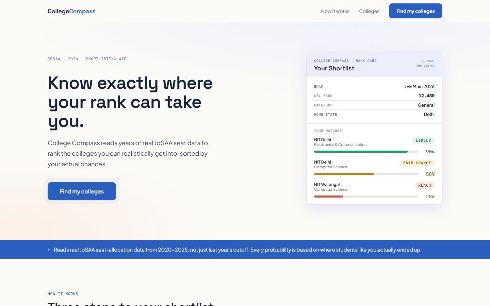
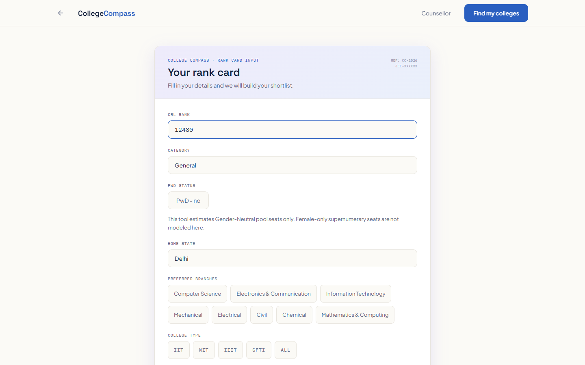
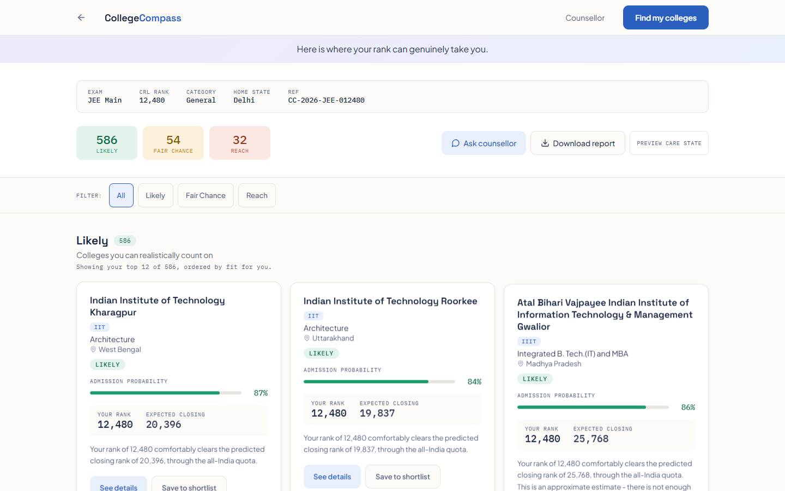
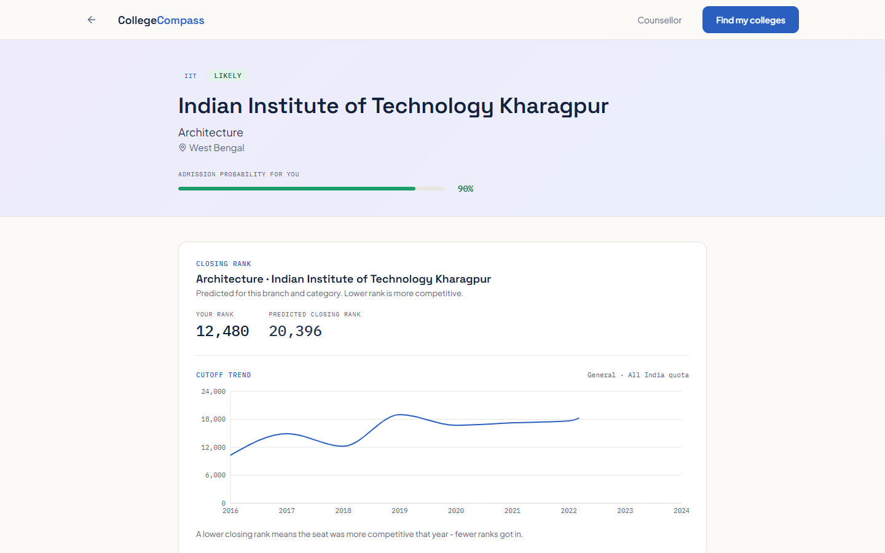
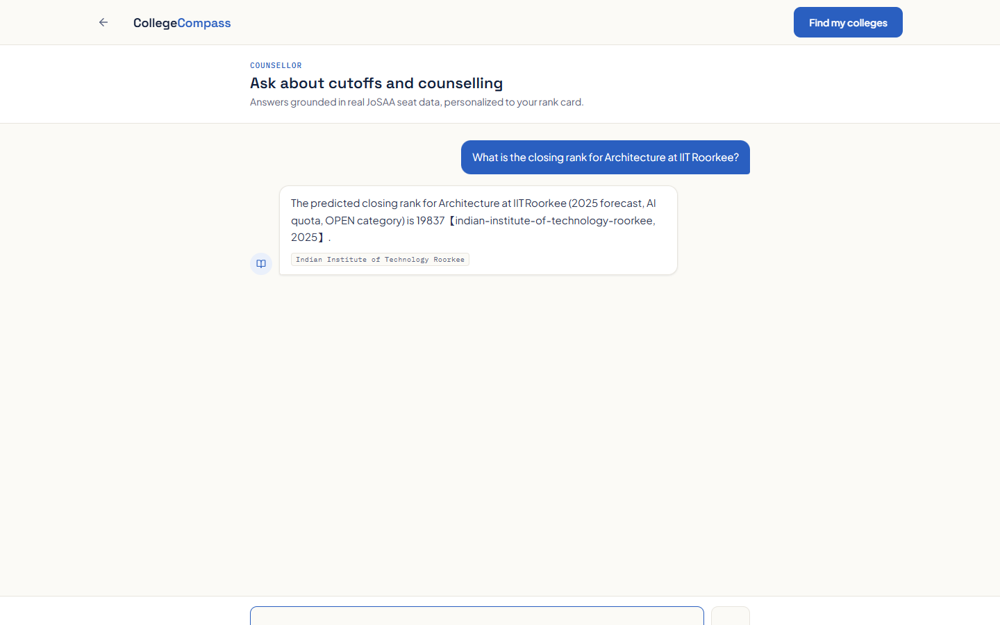
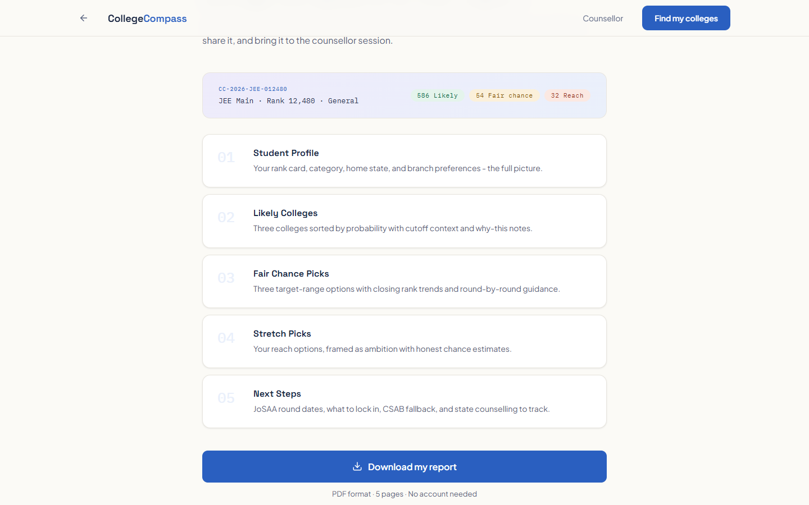
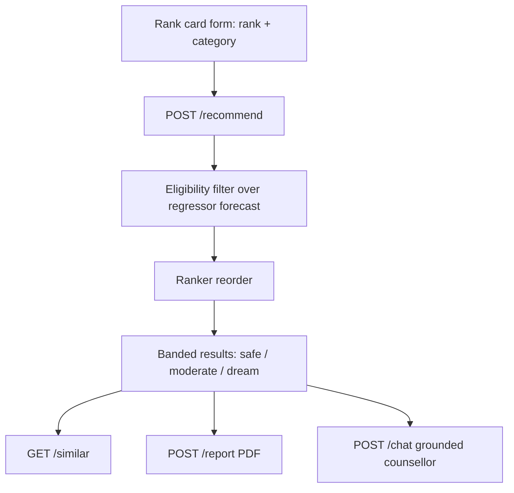

# College Compass

A JEE Main / JoSAA college recommendation system. Give it your rank and
category, get back eligible college-branches banded safe, moderate, and
dream, each with a predicted closing rank and a calibrated admission
probability. It also provides item-to-item "similar colleges" retrieval, a
grounded counsellor chatbot, and a downloadable PDF counselling report.

Live at [college-compass-sandy.vercel.app](https://college-compass-sandy.vercel.app).
The backend, including a browsable API at `/docs`, is at
[college-compass-il7k.onrender.com](https://college-compass-il7k.onrender.com).

This is a decision aid, not an official JoSAA tool and not advice. See
[Scope and limitations](#scope-and-limitations) before you rely on it.

## The honesty premise

Every number on screen is one of three things: real historical JoSAA data,
a model output with an honest error story attached, or the student's own
input echoed back. Nothing is invented, which is what separates this from
the "predictor" sites that guess last year's cutoffs at you with false
confidence.

Two guarantees back that up, both enforced in code, not just written in a
prompt:

- Cold-start estimates are visibly different from confident ones. A college
  with too little year-over-year history gets a hatched confidence bar and
  an "approximate" label, in the UI and in the PDF. Never a clean bar for a
  wobbly number.
- The counsellor chatbot re-extracts every number it states and checks it
  against real retrieved data with an exact match, then against the college,
  year, category and kind of figure its sentence attaches it to. A number
  that doesn't match gets one stricter retry, then gets stripped from the
  answer rather than shown.

## Screenshots

Captured against the live app and a real backend, rank `12480`, category
`General`, home state `Delhi`. That's the same example profile the landing
page's own sample shortlist uses, and it returns a real mix of results: 586
likely, 54 fair chance, 32 reach.

| | |
|---|---|
|  |  |
| The landing page hero, with the sample admit card fully assembled and its probability meters filled in | The rank card filled in with the example profile, before submit |
|  |  |
| Likely, fair chance, and reach results for that profile, each with a real admission probability | The admission probability header and the nine-year cutoff trend for a likely match |
|  |  |
| The counsellor answering a real cutoff question, sourced to the exact college it cites | The report screen, with the shortlist summary and a completed PDF download |

## Architecture, mapped

The request path end to end, from the student's form to every feature it
powers:



The PDF report and the grounded counsellor both reuse this exact
recommendation output. Neither recomputes anything. See "How it works"
below for what happens at each step.

A separate auto-generated dependency graph covers module-level coupling
instead of request flow: 500 nodes and 983 edges across 27 communities,
pulled straight from the source with AST parsing plus semantic extraction,
zero import cycles. Use it to audit coupling, not to follow the request
flow above. It predates the current frontend, so its backend and data
pipeline nodes hold up but its frontend-side nodes describe the previous
UI, due for a refresh. The SVG is at
[docs/architecture-graph.svg](docs/architecture-graph.svg), an interactive
version at [docs/architecture-graph.html](docs/architecture-graph.html),
and the full audit is in
[docs/ARCHITECTURE_GRAPH_REPORT.md](docs/ARCHITECTURE_GRAPH_REPORT.md).

## Build the database

A fresh clone has no `college_compass.db`: it is gitignored, along with the
`data/raw/` and `data/processed/` directories the pipeline builds it from.
Every trained model artifact (regressor, ranker, calibrator, FAISS index)
still ships with the repo and needs none of this. Do one of the two paths
below, once, from the repo root, before [Quickstart](#quickstart).

**Download the published copy (about a minute).** The built database is a
gzip asset on a GitHub release. `scripts/fetch_db.py` downloads it,
decompresses it, and checks the result against a SHA-256 pinned in the
script:

```
pip install -r requirements.txt
python scripts/fetch_db.py
```

A failed download or a checksum mismatch raises and leaves no database
behind. If `college_compass.db` already exists and matches, the script does
nothing. If it exists and differs, for example a copy you rebuilt, the script
refuses to overwrite it. Render's build runs this same script (see
[The live deployment](#the-live-deployment)).

**Or rebuild it from the public sources (a few minutes).**

```
pip install -r requirements.txt
python -m data_pipeline.ingest
python -m data_pipeline.normalize
python -m data_pipeline.build_dataset
```

- `data_pipeline.ingest` downloads every raw source (JoSAA's round-wise
  2016-2020 cutoffs, the 2024 and 2025 snapshots, two independent 2021-2023
  backfills, NIRF's engineering rankings) into `data/raw/`. Every source is
  a public file on GitHub or nirfindia.org, no login or API key. It is
  idempotent, so re-running it after a failed or partial pull only fetches
  what is still missing.
- `data_pipeline.normalize` reconciles those raw sources into
  `data/processed/`, as five Parquet files (colleges, programs, cutoffs,
  seat_counts, nirf_rankings), via `pyarrow`.
- `data_pipeline.build_dataset` loads those Parquet files into
  `college_compass.db` (or `DATABASE_URL`, if set) and prints a coverage
  report naming exactly which year and institute-type combinations have
  real data.

Each step logs its own progress as it runs.

**Publishing a new database.** After a rebuild, compress it, hash the
uncompressed file, and attach the `.gz` to a new GitHub release:

```
python -m gzip college_compass.db
python -c "import hashlib; print(hashlib.sha256(open('college_compass.db', 'rb').read()).hexdigest())"
```

Then set `DB_URL` and `DB_SHA256` at the top of `scripts/fetch_db.py`. The
checksum covers the decompressed file, so any gzip level produces a valid
asset.

## Quickstart

Backend:

```
pip install -r requirements.txt
cp .env.example .env
python -m uvicorn api.main:app --port 8000
```

Every trained model artifact (regressor, ranker, calibrator, FAISS index)
ships with the repo; the database does not (see
[Build the database](#build-the-database)). Startup loads everything once;
the API 503s until that finishes, then stays fast. One exception: the
counsellor's text encoder loads on the first semantic question instead of
at startup, so that first question is slower than the ones after it.

Frontend, in a second terminal:

```
cd frontend
npm install
cp .env.example .env
npm run dev
```

Open the printed local URL (`http://localhost:5173` by default). The
frontend pulls its own category and state options from the backend, so the
two can never drift out of sync.

`VITE_API_BASE` (in `frontend/.env`) is the backend's origin. Leave it blank
for local dev: every API call goes through the Vite dev server's own proxy
(`frontend/vite.config.ts`), which forwards the backend's root-mounted paths
(`/recommend`, `/chat`, `/report`, `/meta`, `/similar`, `/cutoffs`,
`/health`) to `http://localhost:8000`, so the browser never hits a CORS
wall. Set `VITE_API_BASE` to the real backend's origin only when the
frontend is built and served from somewhere the proxy can't reach, for
example a separately hosted static build.

For production, the simplest path is one process: run
`npm run build` inside `frontend/`, and the backend serves the result
directly, static assets and all, the moment `frontend/dist` exists. No
second server or reverse proxy needed. Hosting the frontend separately
works too. Either way, `CORS_ORIGINS` and `VITE_API_BASE` are the only two
settings that change.

### The live deployment

The live instance is the split-hosting case above: a static Vercel build
for the frontend, a separate Render service for the backend. The
frontend's `VITE_API_BASE` points at the Render backend's origin, and the
backend's `CORS_ORIGINS` allows the Vercel origin. That's the whole
connection between them.

Render's build command installs the dependencies, then fetches the database
(the file is not in git):

```
pip install -r requirements.txt && python scripts/fetch_db.py
```

The service opens its port first and loads the models in a background
thread. `GET` and `HEAD /health` answer while that runs and report
`models_loaded: false` until it finishes; every endpoint that needs a model
returns 503 until then. If the load fails, the process exits with status 3,
so a broken deploy fails instead of going live without models. On Linux,
`/health` also reports `rss_mb` and `rss_peak_mb` (current and peak resident
memory), because Render's free plan has no memory graph. Both are `null`
elsewhere.

Set the service's Health Check Path to `/ready` (Settings, Health Check
Path). `/ready` returns 503 until every model is loaded and 200 after. With
it set, Render keeps the old instance serving until the new one answers 200,
so a boot that runs out of memory fails the deploy and the live site stays up.
`/health` stays 200 during the load, for the keep-warm job.

The boot reads only the cutoff rows and columns the forecast uses, in chunks,
and hands the freed Arrow buffers back to the system. On a Windows
measurement that cut the boot peak from about 640 MB to about 320 MB. The live
numbers on Render (2026-10-26) are `rss_mb` 318 to 328 MB after boot and
`rss_peak_mb` 353 to 368 MB, against the 512 MB limit.

A cron-job.org job keeps the free instance awake: `GET /health` every 10
minutes with a 30 second timeout, failure notification on. Use the https
address, because http returns a 301 that cron-job.org counts as a failure. A
sleeping Render instance answers with its own 503 "waking up" page, and a
short ping can fail to start it. If the job is ever paused, open the
site once in a browser and wait for it to load before you turn the job back on.

## How it works

**Data pipeline.** A normalization step reconciles six public sources
(JoSAA round-level cutoffs, NIRF rankings, a hand-maintained fees and
hostel reference table) into one schema and loads it into SQLite. Postgres
is a one-env-var swap away for anyone who wants it; the substrate never
changes what the app computes.

**Cutoff regressor.** A LightGBM model predicts the year-over-year *change*
in a college-branch's closing rank, not the raw rank itself. Trees can't
extrapolate past what they were trained on, so predicting a delta and
adding it to last year's real number keeps every forecast inside the
model's trained range. A separate cold-start fallback model covers
college-branches with too little history for the main one.

**Eligibility and banding.** Given a rank and category, the system resolves
quota against home state and bands every reachable college-branch safe,
moderate, or dream based on how much margin the forecast gives you. This
step decides what you're eligible for; nothing downstream is allowed to
change that.

**Personalization ranker.** An LGBMRanker reorders eligible results by fit
(state, budget, branch taste, NIRF appetite) without ever touching
eligibility. Its relevance label is built from real revealed preference,
and closing-rank-derived signals are deliberately excluded from its
features, so it can't just learn to reconstruct the label from itself.

**Admission probability.** Isotonic calibration, fit on a held-out
validation year, corrects a residual-based raw probability. The result is
rounded to the nearest 5% before it's ever shown, so it never implies more
precision than the model actually has.

**Cutoff trend.** Every result row and the college detail screen carry a
deterministic Tightening, Stable, or Loosening label, built from an
ordinary least squares slope over that college-branch-category-quota's
settled year-over-year closing rank. Below three usable years the label
reads `Insufficient history` instead of guessing. The slope is detrended
first: JoSAA's seat pool expanded broadly from 2016 to 2024, so a raw slope
mostly measures that system-wide drift rather than anything specific to one
college, and a raw threshold once labeled 57% of colleges Loosening, which
told a student nothing. The classifier subtracts the median normalized
slope across the same population (0.0412, fit on 2016-2024 data) before
comparing the result against a neutral band of 0.03. Refit against that
residual distribution, the actual split across colleges with enough history
is 36.6% Stable, 32.7% Tightening, 30.7% Loosening. The whole settled
history table (about 50,600 year-rank pairs) is built once per process and
cached in memory, not re-queried per request, since it only changes when
the database is reingested.

**Round projection.** A naive per-round closing-rank curve, computed on
demand for each `/recommend` row and anchored so the last round always
equals the existing final-round forecast exactly. JoSAA's round count
varies by year (6 rounds in 2016 and 2020-2022, 7 in 2017-2019), so the
ratio between a round's closing rank and the final round's is keyed on
fractional position in the sequence rather than absolute round number, and
computed per category and branch family (CS-adjacent or core) from
2016-2022 data only, since 2023 and 2024 carry no round breakdown. Checked
against two held-out years, trained on the other six each time: a 6-round
season (2021) and a 7-round season (2018), so the win isn't just an
artifact of testing on the round count 2026 happens to share. Both beat
the trivial "every round equals the final round" baseline at every round
position - 2021 by 27-49% depending on position, 37% overall; 2018 by
17-42%, 30% overall. The 7-round year's smaller margin is expected, not a
weakness: its keying folds two of that year's rounds into one bucket, so
part of what the ratio is being scored against is its own compression.
Either way the ratio wins clearly, and 2021 and 2022, the two most recent
years with round data, agree on 6 rounds, which is what 2026 is projected
to be. There is no learned round model: a model trained on 2016-2022 would
have no later year with round data left to validate against, so this
pattern is what ships, not a trained one. Nothing about it is stored; it's
arithmetic on a forecast the system already computed. The ratio table
(`models/round_forecast_ratios.py`) is generated, not hand-maintained -
`python -m models.build_round_ratio_table` refits it from the database and
re-runs both held-out checks, so a future reingest can't leave it silently
stale.

**Grounded counsellor.** The system routes a question to structured lookup
(a named college: its latest actual closing ranks, plus the forecast and
probability numbers `/recommend` already computed when the student gave a rank)
or semantic retrieval (FAISS similarity, for fuzzier questions). Either way it
builds a context bundle where every fact carries its own source.

A closing rank or probability records its college, branch, program, category,
quota, seat pool, year and round. The line the model reads carries the branch
and its program (IIT Delhi's four-year B.Tech and five-year dual degree share a
branch name), category, seat pool and round, after the college and year. The
language model answers from that bundle, and a code-level validator checks every
number in the answer against it before the answer is returned.

The validator reads which college, branch, program length, year, category, seat
pool and round each sentence names, and whether a number sits beside "closing
rank", "NIRF", "fees" or "probability". It accepts a number only if a record
agrees on everything the sentence states.

If a figure is still unsupported after one stricter retry, the counsellor removes
it and the response carries a `verification` note. The note gives the closest
figure on record, chosen by fixed rules, with its college, branch, program,
category, seat pool, quota, year and round, or says plainly that nothing close is
on record. It states a figure only as its own record reads, so it never pairs a
value with the wrong college, branch, program, category, year or round. The
counsellor screen shows the note in a tinted panel under the answer, and the
section [Measuring the counsellor](#measuring-the-counsellor) compares the three
behaviours on a fixed question set.

## Measuring the counsellor

The counsellor answered a fixed set of 44 questions
(`tests/fixtures/eval/counsellor_questions.json`, written before the escalation
code and not edited since) on 2026-10-29, with the real model:
`openai/gpt-oss-120b` on Groq's free tier. Six questions ask for placement or
salary data and get the fixed refusal with no model call. The other 38 ask for a
closing rank: 16 the system holds, 9 for a year or branch it lacks while a close
figure exists, 7 where nothing close exists, and 6 that mix a held figure with a
missing one. One of the 38, V10, no version can answer (see below), so the
tables count 37.

Three versions of the counsellor answered each question:

- **A, no validator.** The model's first answer, as written.
- **B, strip only.** The counsellor before Phase 4. The validator checks the
  answer, the model gets one stricter retry, and a figure that is still
  unsupported becomes "[figure not available in the system's data]". The student
  sees no explanation.
- **C, strip and note.** The counsellor as it runs now: B plus the verification
  note, which says what was removed and offers the closest figure on record or
  says that nothing close is on record.

The versions share their model calls. The first answer to each question is
fetched once and all three read it, and B and C share the retry, so the versions
differ only in what the code does with the same text. The run made 44 calls (38
first answers, 6 retries), 60 seconds apart to stay inside the free tier. Every
check is code. No model grades an answer.

Unsupported claim rate: answers that state a figure no record holds.

| Class (questions) | A | B | C |
| --- | --- | --- | --- |
| Verifiable (15) | 1/15 | 0/15 | 0/15 |
| Near miss (9) | 2/9 | 0/9 | 0/9 |
| Unverifiable (7) | 2/7 | 0/7 | 0/7 |
| Mixed (6) | 1/6 | 0/6 | 0/6 |
| **Overall (37)** | **6/37 (16%)** | **0/37** | **0/37** |

Attribution error rate: answers that state a held figure against a college,
branch, program, category, seat pool, year or round it does not belong to, out of
the answers that state a held figure.

| Class | A | B | C |
| --- | --- | --- | --- |
| Verifiable | 0/15 | 0/15 | 0/15 |
| Near miss | 1/3 | 0/3 | 0/3 |
| Unverifiable | 0/1 | 0/3 | 0/3 |
| Mixed | 0/5 | 0/5 | 0/5 |
| **Overall** | **1/24 (4%)** | **0/26** | **0/26** |

Useful after rejection: of the questions whose first answer the validator
rejected, the final answer says which part it could not verify, offers exactly one
figure from the close list (or says nothing close exists) with all six fields,
names a next step, and states no other figure.

| Class | A | B | C |
| --- | --- | --- | --- |
| Verifiable | 0/1 | 0/1 | 0/1 |
| Near miss | 0/2 | 0/2 | 0/2 |
| Unverifiable | 0/2 | 0/2 | 0/2 |
| Mixed | 0/1 | 0/1 | 0/1 |
| **Overall** | **0/6** | **0/6** | **0/6** |

What each version produced, out of 37 questions:

| Outcome | A | B | C |
| --- | --- | --- | --- |
| Answered cleanly on the first call | 31 | 31 | 31 |
| Rejected, and the retry fixed it | n/a | 3 | 3 |
| Rejected, figure stripped, no note | n/a | 3 | n/a |
| Rejected, figure stripped, note with the closest figure | n/a | n/a | 3 |
| Rejected, figure stripped, note that nothing is close | n/a | n/a | 0 |
| Rejected, nothing done (A has no validator) | 6 | n/a | n/a |
| Refused by the provider | 0 | 0 | 0 |

**What the six rejected answers held.** None is an invented closing rank. Three
name the year the student asked about while saying the records lack it (N03 and
M02 write "2025", N04 writes "2021"). One suggests an example rank (U03, "45
000"). One writes a year inside an example question (U06, "2024"). One is a
correct answer the validator could not read (V09: the model separated the digits
of "8437" with a narrow no-break space). N03 also holds a correct figure, OBC-NCL
50, that the validator flagged because the model wrote the category with a
non-breaking hyphen. Replacing that hyphen clears the flag, and joining V09's
digit groups clears all but one hyphenated figure. In two of the six rejections
the validator turned down a correct figure. [KNOWN_ISSUES.md](KNOWN_ISSUES.md)
lists both.

**What the numbers say about the note.** The retry fixed three of the six
rejected answers (U03, U06, V09), so those students saw no note. In the other
three (N03, N04, M02) the year survived the retry. B stripped it and C added the
note, each time with a figure built from a real record: IIT Bombay Computer
Science and Engineering, OPEN, 68 (N03, N04) and IIT Bombay Mechanical
Engineering, OPEN, 1685 (M02). Useful after rejection reads 0 of 6 in every
version. A recovered answer cannot count, because it carries no note. The three
notes failed the definition as well. The N03 and N04 answers listed other
correct 2024 ranks beside the note's figure, so they stated more than one
figure. The question file's close list for M02 is empty, because the OPEN rank is
the expected answer there, so only a "nothing close" note would count. The note
did not move the one metric it was built to move. It also did not make any
metric worse than A or B.

The note has costs these metrics do not count. It adds text to the answer (twelve
lines on a 375 px screen). Its "nothing close" sentence is false when the removed
claim is a NIRF rank or a fee, or names no branch; no question in this run
triggered that case. It adds no provider call, because B and C share the retry.

**What this run cannot show.**

- The sample is small: 37 questions, one model, one day, six rejections. A class
  holds 6 to 16 questions, so one question moves a rate by 6 to 17 points. A
  second run can differ.
- The model rarely stated a bad figure: 31 of 37 first answers passed the
  validator unchanged. A set built to provoke invented figures would test the
  note harder.
- B and C read 0 on the first two metrics by construction. The production
  validator is also the scorer, and B and C ship only what it passes. Only A shows
  what the model writes unprompted, and a figure the validator wrongly accepts is
  invisible here.
- The validator does not read a round written as a word ("third round"), so
  attribution errors involving a round go uncounted in every version.
- The close list is empty for every verifiable and mixed question, so for those
  classes only a "nothing close" note can count as useful.
- The phrase lists for "says what it could not verify" and "names a next step"
  come from the note's own wording. They measure whether an answer carries the
  note's content, not whether it helped a student.
- No metric checks that a verifiable question received its expected figure. A
  decline reads as clean.

**V10, reported apart.** "Give me the OPEN closing rank for Computer Science at
IIIT Allahabad." All three versions returned the same decline. The retriever
takes "Computer Science" for a branch at IIIT Lucknow and filters Allahabad's
history to nothing, so the model never saw a rank for that college. The question
set stays unedited, so V10 sits outside its class and the totals.

To repeat the run, set the provider variables and run these three commands from
the repository root. The first takes about 45 minutes, and the third writes
`tests/fixtures/eval/counsellor_results.json`.

    python -I models/eval_counsellor.py --run eval_run.jsonl
    python -I models/eval_counsellor.py --rescore eval_run.jsonl
    python -I models/eval_counsellor.py --report eval_run.jsonl

`--rescore` scores the recorded answers again with the current code and makes no
provider call, so a change to the validator can be measured without a new run.

## Scope and limitations

Stated plainly, because a hidden limitation is worse than a stated one.

- **No placement, package, salary, or CTC data, anywhere, ever.** The
  counsellor declines those questions before they reach the language
  model. This is a deliberate exclusion, not a gap.
- **Gender-Neutral seats only.** Female-only supernumerary seats are a
  real, separate, smaller pool this system doesn't cover. The forecast, the
  cutoff chart and the counsellor's cutoff history all leave them out.
- **Forecasts are genuine forecasts.** Any year without a real closing-rank
  label is evaluated on held-out past years, never on data that doesn't
  exist yet.
- **A decision aid, not an official source.** Fees are coarse
  per-institute-type approximations. Check the institute's current fee
  circular before making a real decision.
- **Category rank, not CRL, for reserved categories.** OPEN uses overall
  rank; EWS/OBC-NCL/SC/ST use category rank, matching how JoSAA actually
  publishes its own cutoffs.
- **Grounding judges one sentence at a time.** The validator checks each
  number against the records for the college, branch, program length, year,
  category, seat pool, round and kind of figure its sentence names, and skips
  whatever the sentence leaves out. Two colleges or two categories in the same
  sentence can swap their figures without a flag. It reads a branch only by its
  full name as the records spell it ("Computer Science and Engineering", not
  "CSE"), a program only by its length ("four-year BTech", "5-year dual
  degree", not "dual degree" alone), and it never reads a quota. Detail in
  [KNOWN_ISSUES.md](KNOWN_ISSUES.md).
- **A counsellor question about a college sends at most 112, 90 or 60 of its
  Gender-Neutral cutoff rows from the latest year,** to stay under the
  free-tier limit of 8,000 tokens a minute: 112 with no rank given, 90 with a
  rank, 60 next to a request for alternatives. OPEN rows and the student's own
  category come first. The largest prompt measured over 133 colleges, 16
  profiles and two phrasings is 6,303 tokens with a rank, 6,618 with no
  rank and 6,668 with alternatives. Two questions in one minute can still draw a
  refusal, and so can a retry, which resends the whole prompt. The counsellor
  then says the provider refused the request and suggests a narrower question,
  instead of reporting the model as down.
- **The backend runs on a free instance: 512MB RAM, a fraction of a CPU.**
  Requests are slower than the screenshots suggest.
- **The first counsellor question that doesn't name a specific college is
  the slow one.** It loads the sentence encoder on demand, the same
  tradeoff described in [Quickstart](#quickstart).
- **A cold backend takes time to wake up.** A keep-warm ping hits `/health`
  every ten minutes, so this should be rare. After an idle spell or a
  redeploy, the first request can still land while the models load. It gets
  a 503 ("models are still loading, try again shortly") and the student
  retries by hand. A proper waking-up screen is planned.

Full detail on all of the above, plus what's already been tested and what
hasn't, is in [KNOWN_ISSUES.md](KNOWN_ISSUES.md).

## Tech stack

Backend: FastAPI, SQLAlchemy (SQLite locally, Postgres via one env var).
Machine learning: LightGBM, isotonic calibration, an ONNX Runtime encoder
(all-MiniLM-L6-v2) with a FAISS index. PDF: reportlab. Frontend: React 18,
TypeScript, Vite, react-router for routing, motion for animation, recharts
for the cutoff chart, lucide-react for icons, and a hand-authored
CSS-variable design system with no component framework. Deployed on
Vercel (frontend) and Render (backend).
